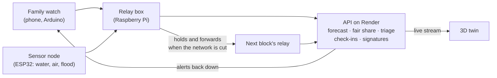

# Hollow Twin

**When the power fails in the Hollow, the deep levels go dark first. When the Directorate cuts the network, nobody can tell their family they are alive. Hollow Twin warns every block before it goes dark, shares the power that is left by a rule anyone can check, and gets a family's "I'm OK" through anyway: over relay boxes in every block, and where even they cannot reach, on a rover that drives the tunnels.**

Patriot HackFest Fall 2026 · Life Underground track · Problems 1, 2, 7, 8 and 10

**[Watch the video](https://youtu.be/hhaYTApHOzI)** · **[Open the live twin](https://hollow-twin.vercel.app)** · **[See the scout rover](https://hollow-twin.vercel.app/scout/)** · **[Try the family watch](https://hollow-twin.vercel.app/watch/)**


## The problem

Two billion people live underground in the Hollow, and the deeper you live, the worse it gets. The Directorate decides who keeps the lights, and it serves the upper levels first. In our scenario a geothermal unit fails: under the Directorate's rule, **12 deep blocks are dark by hour 30 and 8.5 million people have no air fans**. When the Directorate also shuts the network down, families on different levels have no way to tell each other they are safe, and the nearest clinic can be several levels away.

## What Hollow Twin does

| Track problem | What Hollow Twin does about it |
| --- | --- |
| **1.** Blackouts hit without warning | Forecasts every block's battery and warns a block about a day before it runs out, then again at 8 hours. The warning reaches every watch in the block |
| **2.** The deep levels always lose the power | Replaces "upper levels first" with a rule anyone can check: every block keeps its air, pumps and clinic running, then the rest is shared per person. **Same supply, 12 dark blocks become 0** |
| **7.** The Directorate can shut the network off | Relay boxes in every block store messages and pass them block to block until one gets a line out. Each message carries the route it took |
| **8.** Families cannot tell if each other are OK | The family watch: one tap of **I'M OK** reaches the family over those relays. Families see who is safe, who needs help and who has not been heard from, and can talk in presets or Morse code |
| **10.** Medicine runs out first in the deep levels | Help calls are ranked by the caller's oxygen and pulse with NEWS2, the early warning score hospitals use, so the sickest person goes first. **The scout rover** drives a med kit to blocks the relays cannot reach and carries their held messages back out |

## Try it in two minutes

| | |
| --- | --- |
| **The twin.** Press **Play the 75-second story**, then click any block to step inside | https://hollow-twin.vercel.app |
| **The family watch.** Open it on your phone and tap **I'M OK** | https://hollow-twin.vercel.app/watch/ |
| **The watch in 3D**, running the real watch software on its screen. Cut the network, or simulate a fall | https://hollow-twin.vercel.app/watch/device/ |
| **AR.** Try the watch on your wrist, or put the rover in your room at real size | https://hollow-twin.vercel.app/ar/ |
| **The scout rover.** Its CAD design pulled apart, its parts list, and a mission down a flooded tunnel | https://hollow-twin.vercel.app/scout/ |

The watch pages open in demo mode, with the family's replies simulated, so they work for anyone. Sending to the live API needs the team's key.

## The scout rover

When both the network and the tunnels fail, someone has to go in. The scout rover is a six-wheel rocker-bogie, the same suspension idea as the Mars rovers, so all six wheels stay on rubble without springs ([`robot/`](robot/)).

- **Carries supplies:** a med kit, a battery pack or water filters, to a block that called for help.
- **Carries messages:** it has the same relay box as every block, so it collects what a cut-off block is holding and brings it back into range.
- **Checks tunnels** before people use them: it climbs rubble, folds its camera mast to pass under a fallen duct, and measures flood water with a probe. It reports open or closed in the same message format as every other device.

We did not have the time or the parts to build it this week, so we designed it completely: **57 parts and 15 joints, 11.9 kg, about $1,240 in parts**, every motor, sensor and battery a part you can buy today. The model is written in CadQuery and exports STEP (any CAD program), URDF (robot simulators) and STL for printing. Cut the aluminium frame, print the wheels and brackets, order the parts list, and it is buildable.

In the twin, open any block and press **Send the rover**. Connected to the API, the rover takes the help request, and when it arrives the API closes the request and tells the resident's watch "rover-01 reached you".

## How it works



Every part speaks one message format, [`CONTRACT.md`](CONTRACT.md), so the team built in parallel without waiting on each other.

- **The API** ([`api/`](api/)) is Node.js with no dependencies, hosted on Render: 25 endpoints and 138 passing tests. It forecasts each block's battery from its drain rate, allocates power under both rules, ranks help calls with NEWS2, delivers family check-ins and streams everything live. Messages that arrive late after a network cut are stored in the order they were measured, with the route they travelled.
- **Nothing is taken on trust.** Every device signs its messages (HMAC-SHA256). A forged reading is refused and listed publicly at `/forgeries`. An impossible sensor reading is flagged as a fault instead of setting off a false alarm. All 29 safety limits cite a published source (OSHA, NIOSH, WHO, US EPA, Health Canada, the US National Weather Service, NEWS2); the battery warning levels are our own choice, and the screen says so.
- **The twin** ([`twin/`](twin/)) is one three.js page with no build step: a cutaway of nine levels, 70 blocks and 32 million people. Every number on screen says where it came from: the built-in simulation, scripted data through the API, or a device.
- **The edge:** a Raspberry Pi relay in Python ([`firmware/relay/`](firmware/relay/)) holds messages through a cut and hands them relay to relay; firmware for an Arduino watch ([`firmware/watch/`](firmware/watch/)) and an ESP32 sensor node ([`firmware/sensor/`](firmware/sensor/)).
- **The hardware designs:** the watch (28 parts, 45 mm, about $64) and the rover, both modelled in CAD the same way.


## What is real and what is designed

We would rather tell you than have you find out.

| Part | Status |
| --- | --- |
| The twin, the guided story, the power rules | Real, running at the link above |
| The API | Real, with 138 passing tests, hosted at https://hollow-twin-api.onrender.com and read by the public twin by default. Open the twin with `?api=off` to see the built-in simulation alone; the story's numbers (12 blocks, 8.5 million people) come from it |
| The family watch on a phone | Real: a web page that sends to the API, with I'm OK, help, I feel sick, the family list, presets and Morse |
| The relay, watch and sensor code | Real code. Our team was spread across 1,400 miles, so it was tested in simulation: the relay against the real API with a stand-in watch and real network cuts, the ESP32 firmware on a simulated board. It has not yet run on the physical boards ([`docs/HARDWARE.md`](docs/HARDWARE.md)) |
| Radio links between relays | Simulated. The relay-to-relay handoff is real software over the local network, standing in for radio |
| The watch and rover hardware | Designed in CAD and simulated, not built |
| Sensor readings, populations, the failure scenario | Simulated, and tagged as simulated on screen |

## Run it yourself

Needs Node 20 or newer and Python 3. Nothing to install.

```sh
# 1. The API, on http://localhost:8787
cd api && npm start

# 2. The twin, in a second terminal
cd twin && python3 -m http.server 8080
# open http://localhost:8080/?api=http://localhost:8787

# 3. Play a scripted network cut through the API and watch it arrive in the twin
cd api && npm run scenario -- networkcut
```

Other scenarios: `blackout`, `fairshare`, `water`, `outbreak`, `care`, `surface`. Tests: `cd api && npm test`.

## Also in the prototype

Working, but beyond the five problems above: an outbreak simulator that spreads a disease along tunnels, lifts and water lines and lets you quarantine blocks; water and flood layers; a map of sickness reported by residents against the Directorate's official count, with the data downloadable for researchers with identities removed ([`/research`](https://hollow-twin.vercel.app/research/)); and a public page that tells everyone whether the surface is safe ([`/broadcast`](https://hollow-twin.vercel.app/broadcast/)).

## Team

| | |
| --- | --- |
| **Anudeep Bonagiri** (`anudeep-bonagiri`) | The 3D twin and its guided story, the scout rover (CAD design and tunnel mission), the Raspberry Pi relay and Arduino watch code, the README, the submission and the video |
| **Sandeep Madhavarapu** (`SandeepMadhavarapu`) | The API and the message contract: forecasts, fair-share allocation, NEWS2 help ranking, signed messages and the forgery log, 138 tests, the ESP32 sensor node with its simulated-hardware test bench, and the hosted API |
| **Akshaya Pabbisetty** (`akshaya-pabbisetty`) | The family watch on a phone, the 3D watch running the real watch software, AR try-on and the rover in your room, and the poster art |

Built during the event, Nov 14 to 20, 2026. How we worked: [`TEAM.md`](TEAM.md).
