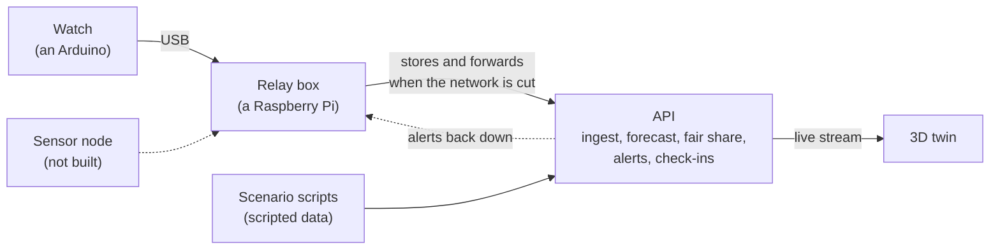

# Hollow Twin

**When the power fails in the Hollow, the deep levels go dark first, and when the Directorate cuts the network, nobody can tell their family they are alive. Hollow Twin warns each block before it goes dark, shares the power that is left fairly, and gets "I'm OK" through anyway: over relay boxes in every block, and where even they cannot reach, on a rover that drives the tunnels carrying messages and supplies.**

Patriot HackFest Fall 2026, Life Underground track.

**Try it: https://hollow-twin.vercel.app** and press **Play the 75-second story**.

**Watch the video: https://youtu.be/hhaYTApHOzI**


## The problem we picked

Five problems from the track, because they are one event seen from five sides: a power failure in a place where the government controls the power, the network and the news.

| Track problem | What Hollow Twin does about it |
| --- | --- |
| 1. Blackouts last for days and nobody knows when the next one hits | Forecasts every block's battery, hours ahead, and warns the blocks that will run dry before their lights go out. The warning reaches every watch in that block, and the watch shows its block's hours of power left |
| 2. The Directorate decides who keeps the lights, and the deep levels always lose | Replaces "upper levels first" with a rule anyone can check: every block's air, pumps and medical load first, then the rest per person |
| 7. The Directorate can shut the network down whenever it wants | Relay boxes in each block store messages and pass them block to block, to the first relay that still has a line out, or upload the backlog when the network returns. Each message carries the route it took |
| 8. Families split across levels cannot tell if each other are OK | One "I'm OK" press travels over those relays to the family's watches, with the route it took |
| 10. Medicine runs out first in the deep levels, far from any clinic | **The scout rover** rides the lift and drives the tunnels to a block that asked for help, with a med kit, a battery pack or water filters. It carries a relay box, so it also collects the messages a cut-off block is holding and brings them back into range. On the way it checks that the tunnel is passable |

## The scout rover

Our most distinctive part: a six-wheel rocker-bogie rover, designed in CAD down to every part, joint and bolt-on sensor ([`robot/`](robot/)). It is the physical link when both the network and the tunnels fail.

- **Carries supplies** to blocks that cannot reach a clinic or a depot.
- **Carries communications:** it has the same relay box as every block, so it drives to where the signal is and brings held messages out.
- **Scouts tunnels** before people use them, and reports open or closed in the same message format as every other device.

In the twin, open any block and press **Send the rover**, or send it to a help request from the overview's help list. Connected to the API, the rover takes the request, and when it arrives the API closes the request and tells the resident's watch "rover-01 reached you" (on the Arduino it beeps). The full design (CAD model, parts list, a mission down a flooded tunnel) is at [hollow-twin.vercel.app/scout](https://hollow-twin.vercel.app/scout/). The rover is designed and simulated, not built.

In the story's scenario a geothermal unit fails. Under the Directorate's rule, 12 deep blocks are dark by hour 30 and 8.5 million people have no fans or scrubbers. With the same supply shared fairly, no block goes dark.

## What you are looking at

One sector of the Hollow in the year 2124, 37 years after the collapse: nine levels, 70 blocks, 32 million people, from the surface down to a geothermal plant 2,560 m underground.

- **Play the story** for the pitch in about a minute.
- **Click any block** (or search for one, such as Rivet Gallery) to step inside: its readings, its forecast, its history, and what you can do for it.
- **Switch the power rule** between Directorate and Fair share and watch who goes dark.
- **Cut the Directorate network** and watch the block relays take over.

## How it works



- **`api/`**: a Node API with no dependencies. It takes messages in one shared format ([`CONTRACT.md`](CONTRACT.md)), forecasts each block's battery, computes who gets power under each rule, raises alerts, delivers family check-ins, and streams everything out live. A backlog that arrives late after a network cut is stored in the order it was measured, with the route it travelled.
- **`twin/`**: one HTML page. Connected to the API, it shows what the API knows, block by block, and lets the API decide the power allocation. On its own, it runs a built-in simulation of the same sector.
- **Every alert cites its limit.** CO2, heat, flood depth and water limits come from published standards (Health Canada, OSHA, the US National Weather Service, WHO, US EPA). The battery warning levels (24 h and 8 h) are our own choice, and the screen says so.


## Real or simulated?

We would rather tell you than have you find out.

| Part | Status |
| --- | --- |
| The 3D twin, the guided story, block cards, the power rules | Real and running at the link above |
| The API: ingest, live stream, forecast, fair share, alerts, check-in delivery, replay after a network cut | Real code with 138 passing tests, hosted on Render at https://hollow-twin-api.onrender.com, and read by the public twin by default. Open the twin with `?api=off` to see the built-in simulation alone; the story numbers quoted here (12 blocks, 8.5 million people) come from it |
| Sensor readings, populations, the failure scenario | Simulated. The screen tags every reading as twin simulation, scripted data through the API, or a device |
| The family watch on a phone | Real: a web page on a real phone, sending to the API. I'm OK, help (two taps), I feel sick, family status, walkie-talkie presets and Morse; it shows its block's power forecast and its help call from queued to delivered. Its relay hops during a cut are drawn, not radioed ([`firmware/watch/`](firmware/watch/)) |
| One watch and one relay box | Real: an Arduino with I'm OK, help and I feel sick buttons and a buzzer, and a Raspberry Pi that signs its messages, holds them while the network is down and uploads them when it returns ([`docs/HARDWARE.md`](docs/HARDWARE.md)). The family member upstairs is scripted |
| Relay to relay | Real software: a cut-off relay hands its held messages to the next block's relay, which uploads them (two relays, the Pi and a laptop). Their link is the local network, standing in for radio; radio hardware is not built |
| The other 68 relays, sensor nodes, vitals sensors | Simulated or scripted. The twin draws the other relays' hops and says so |

## Run it yourself

Needs Node 20 or newer and Python 3. Nothing to install.

```sh
# 1. The API, on http://localhost:8787
cd api && npm start

# 2. The twin, in a second terminal
cd twin && python3 -m http.server 8080
# open http://localhost:8080/?api=http://localhost:8787

# 3. Play a scripted network cut through the API and watch it arrive in the twin
cd api && npm run scenario -- networkcut
```

Other scenarios: `blackout`, `fairshare`, `water`, `outbreak`, `care`, `surface`. API tests: `cd api && npm test`.

## Also in the prototype

Built while exploring the track, and working, but not part of the claim above: an outbreak simulator that spreads a disease along tunnels, lifts and water lines and lets you quarantine blocks; water and flood layers; a map of sickness reported by residents (the "I feel sick" button on either watch) against the Directorate's number, ranking where the rover should take med kits first, with the data downloadable for researchers with identities removed ([`/research`](https://hollow-twin.vercel.app/research/)); and a surface-safety verdict with a public, read-only [surface broadcast page](https://hollow-twin.vercel.app/broadcast/) that shows every reading against its published limit.

## Team

`anudeep-bonagiri`, `SandeepMadhavarapu`, `akshaya-pabbisetty`. Built during the event, Nov 14 to 20, 2026.

How we work together: [`TEAM.md`](TEAM.md). The plan to the deadline: [`docs/PLAN.md`](docs/PLAN.md).
