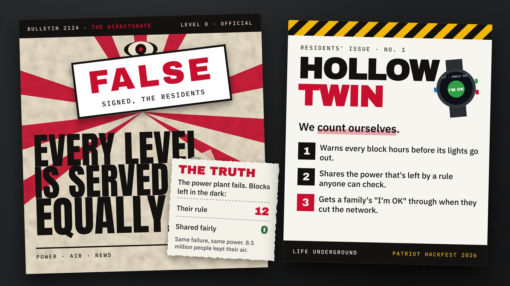
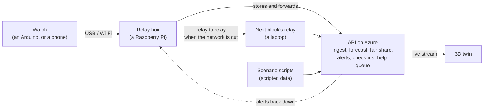

# Hollow Twin



**When the power fails in the Hollow, the deep levels go dark first. When the Directorate cuts the network, nobody can tell their family they are alive. Hollow Twin warns each block before it goes dark, shares the power that is left fairly, and gets "I'm OK" through anyway: over relay boxes in every block, and where even they cannot reach, on a rover that drives the tunnels.**

Patriot HackFest Fall 2026, Life Underground track. Problems 1, 2, 7, 8 and 10.

### ▶ [Watch the 3-minute video](VIDEO_LINK)

## Try it in 30 seconds

| | |
| --- | --- |
| **The twin**: press **Play the 75-second story** | https://hollow-twin.vercel.app |
| **The family watch**: open it on your phone, press **I'M OK** | https://hollow-twin.vercel.app/watch/ |
| **The watch in 3D**, with the real watch software on its screen: press its buttons, cut the network, simulate a fall | https://hollow-twin.vercel.app/watch/device/ |
| **AR**: try the watch on your wrist with your phone's camera, or put the scout rover in your room at real size | https://hollow-twin.vercel.app/ar/ |
| **The scout rover**: the CAD design, pulled apart, and a mission down a flooded tunnel | https://hollow-twin.vercel.app/scout/ |
| **The twin on the live API**: what the team's devices and scripts are sending right now | https://hollow-twin.vercel.app/?api=https://hollow-twin-api.azurewebsites.net |

The watch, the 3D watch and AR open in demo mode, with the family's replies simulated, so they work for anyone. Sending to the live API needs the team's key.

## The problem we picked

Five problems from the track, because they are one event seen from five sides: a power failure in a place where the government controls the power, the network and the news.

| Track problem | What Hollow Twin does about it |
| --- | --- |
| 1. Blackouts last for days and nobody knows when the next one hits | Forecasts every block's battery, hours ahead, and warns the blocks that will run dry before their lights go out. The warning reaches every watch in that block, and the watch shows its block's hours of power left |
| 2. The Directorate decides who keeps the lights, and the deep levels always lose | Replaces "upper levels first" with a rule anyone can check: every block's air, pumps and medical load first, then the rest per person. In our scenario, 12 dark blocks become 0 on the same supply |
| 7. The Directorate can shut the network down whenever it wants | Relay boxes in each block store messages and pass them block to block, to the first relay that still has a line out, or upload the backlog when the network returns. Each message carries the route it took |
| 8. Families split across levels cannot tell if each other are OK | The family watch: one press of **I'M OK** reaches the family's watches over those relays. Families see who is safe, who needs help and who has not been heard from, and can talk by preset messages or Morse code |
| 10. Medicine runs out first in the deep levels, far from any clinic | **The scout rover** rides the lift and drives the tunnels to a block that asked for help, with a med kit, a battery pack or water filters. It carries a relay box, so it also brings a cut-off block's held messages back into range. A help call is ranked by the caller's vitals: low blood oxygen and a racing pulse move it up the queue |

## The family watch

What a resident wears. Three buttons: green **I'M OK**, red **HELP** (hold it, so a knock can't call for help) and a blue **Morse key** for when you can't look or speak. Inside: an ESP32, a **LoRa radio** for when the network is cut, a heart-rate and blood-oxygen sensor, skin temperature, a motion sensor that notices falls, a vibration motor and a buzzer ([`firmware/watch/`](firmware/watch/)).

- **On a phone**, the watch's software runs today and talks to the API: I'M OK, help, "I feel sick", the family's status, walkie-talkie presets and Morse, its block's power forecast, and its help call from queued to delivered.
- **On an Arduino**, a real watch with I'M OK, help and I feel sick buttons and a buzzer, carried by a real relay box ([`docs/HARDWARE.md`](docs/HARDWARE.md)).
- **In 3D**, the wearable they become, drawn in CAD the same way as the rover: 28 parts, 45 mm, about $64 in parts. Its screen runs the real phone watch software, and the page plays the hardware: cut the network and its antenna sends by LoRa; simulate a fall and it asks "Are you OK?", then calls for help by itself.
- **In AR**, on your own wrist.

## The scout rover

A six-wheel rocker-bogie rover, designed in CAD down to every part, joint and bolt-on sensor ([`robot/`](robot/)). It is the physical link when both the network and the tunnels fail.

- **Carries supplies** to blocks that cannot reach a clinic or a depot.
- **Carries communications:** it has the same relay box as every block, so it drives to where the signal is and brings held messages out.
- **Scouts tunnels** before people use them, and reports open or closed in the same message format as every other device.

In the twin, open any block and press **Send the rover**, or send it to a help request from the help list. Connected to the API, the rover takes the request; when it arrives, the API closes the request and tells the resident's watch "rover-01 reached you" (on the Arduino it beeps). The rover is designed and simulated, not built.

## How it works



- **`api/`**: a Node API with no dependencies and 135 tests, hosted on Azure. It takes messages in one shared format ([`CONTRACT.md`](CONTRACT.md)), forecasts each block's battery, computes who gets power under each rule, raises alerts, delivers family check-ins, ranks help calls and streams everything out live. A backlog that arrives late after a network cut is stored in the order it was measured, with the route it travelled. Forged messages (a wrong signature) are refused and made public.
- **`twin/`**: one HTML page. Connected to the API, it shows what the API knows, block by block, and lets the API decide the power allocation. On its own, it runs a built-in simulation of the same sector.
- **Every alert cites its limit.** CO2, heat, flood depth, water and vitals limits come from published standards (Health Canada, OSHA, the US National Weather Service, WHO, US EPA, the Royal College of Physicians' NEWS2). The battery warning levels (24 h and 8 h) are our own choice, and the screen says so.


## What is real and what is simulated

We would rather tell you than have you find out.

| Part | Status |
| --- | --- |
| The 3D twin, the guided story, block cards, the power rules | Real, at the link above |
| The API: ingest, live stream, forecast, fair share, alerts, check-in delivery, help queue, replay after a network cut, forgery refusal | Real code with 135 tests, hosted at https://hollow-twin-api.azurewebsites.net (reads are open; writes need the team's key) |
| The family watch on a phone | Real: a web page on a real phone, sending to the API. Its relay hops during a cut are drawn, not radioed |
| One watch and one relay box | Real: an Arduino and a Raspberry Pi that signs its messages, holds them while the network is down, and uploads them when it returns |
| Relay to relay | Real software: a cut-off relay hands its held messages to the next block's relay, which uploads them. Their link is the local network standing in for radio; radio hardware is not built |
| The watch in 3D and in AR | Real software (the phone watch runs on its screen), and a CAD design for the case and the parts inside, which has not been built. AR hand tracking runs in the phone's browser |
| The scout rover | Designed in CAD and simulated, not built |
| Sensor readings, populations, the failure scenario, the other 68 relays, vitals | Simulated or scripted. The screen tags every reading as twin simulation, scripted data through the API, or a device |

## Run it yourself

Needs Node 20 or newer and Python 3. Nothing to install.

```sh
# 1. The API, on http://localhost:8787
cd api && npm start

# 2. The twin, in a second terminal
cd twin && python3 -m http.server 8080
# open http://localhost:8080/?api=http://localhost:8787

# 3. Play a scripted network cut through the API and watch it arrive in the twin
cd api && npm run scenario -- networkcut
```

Other scenarios: `blackout`, `fairshare`, `water`, `outbreak`, `care`, `surface`. API tests: `cd api && npm test`. The watch: open `http://localhost:8080/watch/?api=http://localhost:8787`.

## Also in the prototype

Built while exploring the track, and working, but not part of the claim above: an outbreak simulator that spreads a disease along tunnels, lifts and water lines and lets you quarantine blocks; water and flood layers; a map of sickness reported by residents (the "I feel sick" button) against the Directorate's number, ranking where med kits go first, with the data downloadable for researchers with identities removed ([`/research`](https://hollow-twin.vercel.app/research/)); and a surface-safety verdict with a public, read-only [surface broadcast page](https://hollow-twin.vercel.app/broadcast/) that shows every reading against its published limit.

## Team

`anudeep-bonagiri`, `SandeepMadhavarapu`, `akshaya-pabbisetty`, `Fundamental333`. Built during the event, Nov 14 to 20, 2026.

How we work together: [`TEAM.md`](TEAM.md). The plan to the deadline: [`docs/PLAN.md`](docs/PLAN.md). The video script: [`docs/VIDEO.md`](docs/VIDEO.md).
